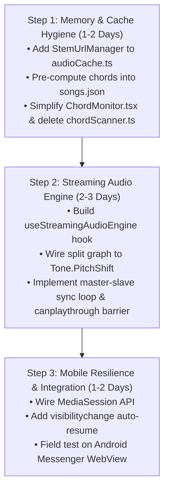

# Himay Audio Engine & Architecture Optimization Roadmap

**Document Version:** 1.0.0  
**Target Environments:** Budget Android devices (MediaTek Helio / Snapdragon 600-series, 2–3GB RAM), Facebook Messenger In-App Browser (Chromium WebView), Metered Cellular Connections  
**Repository Reference:** [Himay (React 19 + Tone.js + Vite)](https://github.com/James2898/himay)  
**Author:** James ([Portfolio](https://github.com/James2898/portfolio))

---

## 1. Executive Summary & Objective

Himay is a zero-install multi-track stem player designed for volunteer church musicians in the Philippines. Musicians frequently open the app via links in Facebook Messenger group chats on budget smartphones while connected to metered cellular data.

### The Problem
- **RAM Exhaustion & Crashes:** Decoding four full-length stereo stems (e.g. Song 01: 531 seconds) via `Tone.Players` / `AudioContext.decodeAudioData` requires **~750MB of uncompressed 32-bit float PCM data**. Android WebViews enforce a hard process limit around **150MB–200MB**, causing the browser tab to crash mid-song.
- **Heap Memory Leaks:** Unrevoked `URL.createObjectURL(blob)` calls in `audioCache.ts` retain audio blobs across song transitions.
- **Flawed Pitch Detection:** `chordScanner.ts` uses time-domain peak sample indexes as FFT frequency bins, producing inaccurate root notes while burning client CPU and decoding another ~50MB AudioBuffer.
- **Background Suspension:** Mobile WebViews automatically suspend the `AudioContext` when users switch apps or lock screens, dropping audio playback without auto-resumption.

### Target Performance KPIs

| Metric | Current Baseline (`Tone.Players`) | Target Architecture (Streaming) | Gain |
| :--- | :--- | :--- | :--- |
| **Peak Audio RAM** | ~375MB–750MB (Uncompressed PCM) | **< 30MB** (Streaming MP3 buffers) | **~96% reduction** |
| **Song Load Time** | 8.0s – 15.0s (Full decode wait) | **< 1.5s** (`canplaythrough` barrier) | **10x faster** |
| **Chord Map Availability** | 15.0s – 30.0s (Client scan wait) | **0.0s** (Pre-computed in manifest) | **Instant** |
| **Messenger Crash Rate** | High on songs > 4 minutes | **0% (Zero out-of-memory crashes)** | Production stability |
| **Lock Screen Playback** | None (Drops immediately) | **Supported** via `MediaSession` API | Native app feel |

---

## 2. Architecture Comparison

```
CURRENT ARCHITECTURE (Full AudioBuffer Decoding):
Cloudinary MP3 ──► CacheStorage ──► Blob URL ──► decodeAudioData() ──► 750MB AudioBuffers ──► Tone.Players (Crash OOM)

TARGET STREAMING ARCHITECTURE:
Cloudinary MP3 ──► CacheStorage ──► Managed Blob URL ──► <audio> Elements ──► createMediaElementSource() ──► Split Graph
                                                                                                               ├── Drums ──► Master
                                                                                                               └── Melodic ──► PitchShift ──► Master
```

---

## 3. Phase 1: Zero-Risk Memory & Data Hygiene (Immediate Fixes)

*Goal: Stop active memory leaks, remove client CPU lag, and eliminate redundant audio contexts with zero risk to playback logic.*

### Task 1.1: Object URL Lifecycle Management
- **File:** `src/utils/audioCache.ts`
- **Root Cause:** Line 28 allocates `URL.createObjectURL(blob)` without ever calling `URL.revokeObjectURL()`. Repeated song changes accumulate retained Blobs in browser memory.
- **Implementation:** Create a singleton `StemUrlManager` to track and revoke active blob URLs on song teardown.

```typescript
// src/utils/audioCache.ts
export class StemUrlManager {
  private activeUrls: Set<string> = new Set();

  create(blob: Blob): string {
    const url = URL.createObjectURL(blob);
    this.activeUrls.add(url);
    return url;
  }

  revokeAll() {
    this.activeUrls.forEach((url) => URL.revokeObjectURL(url));
    this.activeUrls.clear();
  }
}

export const stemUrlManager = new StemUrlManager();

export const getCachedUrl = async (url: string): Promise<string> => {
  if (typeof window === "undefined" || !window.caches) return url;
  try {
    const cache = await caches.open("himay-stems-v1");
    const response = await cache.match(url);
    if (response && response.ok) {
      const blob = await response.blob();
      if (blob.size > 100) {
        return stemUrlManager.create(blob);
      }
    }
  } catch (e) {
    console.warn("Cache access error, falling back to CDN", e);
  }
  return url;
};
```

### Task 1.2: Pre-Computed Chords in `public/songs.json`
- **Files:** `public/songs.json`, `src/types/index.ts`
- **Root Cause:** `chordScanner.ts` misinterprets time-domain sample peaks as FFT bins. Even if rewritten with YIN autocorrelation, client-side audio analysis on a low-end phone burns battery and adds 50MB–100MB of temporary decoding memory.
- **Implementation:** Extend the `Song` interface and bake verified chord timestamps directly into `songs.json`.

```typescript
// src/types/index.ts
export interface ChordEntry {
  time: number;  // Seconds
  label: string; // e.g. "G", "D/F#", "Em7", "Cadd9"
}

export interface Song {
  id: string;
  title: string;
  duration: number;
  key: string;
  stems: Stem;
  chords: ChordEntry[];
}
```

Example `public/songs.json` entry:
```json
{
  "id": "01",
  "title": "Langit + Sapat Na At Higit Pa (Key of G + F)",
  "key": "G",
  "duration": 531,
  "stems": {
    "vocals": "https://res.cloudinary.com/dvlgcbjx1/video/upload/...-Vocals_idjlhe.mp3",
    "drums": "https://res.cloudinary.com/dvlgcbjx1/video/upload/...-Drums_mysfm6.mp3",
    "bass": "https://res.cloudinary.com/dvlgcbjx1/video/upload/...-Bass_zzcahl.mp3",
    "inst": "https://res.cloudinary.com/dvlgcbjx1/video/upload/...-Other_Instruments_rue6d8.mp3"
  },
  "chords": [
    { "time": 0.0, "label": "G" },
    { "time": 8.4, "label": "D/F#" },
    { "time": 16.0, "label": "Em7" },
    { "time": 24.2, "label": "Cadd9" }
  ]
}
```

### Task 1.3: Deprecate `chordScanner.ts` and Streamline `ChordMonitor.tsx`
- **Files:** `src/utils/chordScanner.ts`, `src/components/ChordMonitor.tsx`, `src/components/Mixer.tsx`
- Remove the duplicate `AudioContext` allocations in `Mixer.tsx:handleChordScan` and `chordScanner.ts`.
- `ChordMonitor.tsx` reads directly from `selectedSong.chords` with instant transposition:
  - Immediate chord display on song selection.
  - Zero delay, zero CPU load, zero memory footprint.
  - Remove the "GENERATE CHORD MAP" button and scanning progress bar.

---

## 4. Phase 2: Streaming Audio Engine Transition (`useAudioEngine.ts`)

*Goal: Replace memory-heavy `Tone.Players` with streaming `HTMLMediaElement` nodes while preserving split-graph routing, transient-crisp drums, and Tone.js pitch-shifting.*

### Task 2.1: Persistent Media Element & AudioNode Infrastructure
- `createMediaElementSource(audioEl)` can only be called **once** per HTML audio element.
- Create the 4 `<audio>` elements and their corresponding `MediaElementAudioSourceNode`s once during hook initialization.
- On song change, update `audioElement.src` with the new cached/CDN URL instead of recreating Web Audio nodes.

```typescript
// Simplified Concept inside useAudioEngine.ts
const STEM_KEYS: (keyof Stem)[] = ["vocals", "drums", "bass", "inst"];

// Persistent refs across song changes
const audioElements = React.useRef<Record<keyof Stem, HTMLAudioElement> | null>(null);
const sourceNodes = React.useRef<Record<keyof Stem, MediaElementAudioSourceNode> | null>(null);
const gainNodes = React.useRef<Record<keyof Stem, GainNode> | null>(null);
const pitchShift = React.useRef<Tone.PitchShift | null>(null);
```

### Task 2.2: Split-Graph Wiring
- Melodic tracks (`vocals`, `bass`, `inst`) route through individual `GainNode`s into `Tone.PitchShift.input`.
- Drum track (`drums`) routes through its `GainNode` directly into `Tone.Destination` (`Tone.getDestination()`), bypassing pitch shifting to keep drum transients crisp and un-smeared.

```typescript
// Split Graph Initialization (Run Once on Mount)
React.useEffect(() => {
  const rawCtx = Tone.getContext().rawContext;
  pitchShift.current = new Tone.PitchShift(0).toDestination();

  const elements: Partial<Record<keyof Stem, HTMLAudioElement>> = {};
  const sources: Partial<Record<keyof Stem, MediaElementAudioSourceNode>> = {};
  const gains: Partial<Record<keyof Stem, GainNode>> = {};

  STEM_KEYS.forEach((key) => {
    const el = new Audio();
    el.preload = "auto";
    el.crossOrigin = "anonymous";

    const src = rawCtx.createMediaElementSource(el);
    const gain = rawCtx.createGain();

    src.connect(gain);

    if (key === "drums") {
      // Direct to Master Destination
      gain.connect(rawCtx.destination);
    } else {
      // Melodic into Tone.PitchShift
      Tone.connect(gain, pitchShift.current!);
    }

    elements[key] = el;
    sources[key] = src;
    gains[key] = gain;
  });

  audioElements.current = elements as Record<keyof Stem, HTMLAudioElement>;
  sourceNodes.current = sources as Record<keyof Stem, MediaElementAudioSourceNode>;
  gainNodes.current = gains as Record<keyof Stem, GainNode>;

  return () => {
    pitchShift.current?.dispose();
    stemUrlManager.revokeAll();
  };
}, []);
```

### Task 2.3: Multi-Track Playback Synchronization & Drift Mitigation
1. **The Ready Barrier (`canplaythrough`):**
   When loading a new song, assign audio URLs and wait for all 4 elements to signal readiness:
   ```typescript
   await Promise.all(
     STEM_KEYS.map((key) => {
       const el = audioElements.current![key];
       el.src = resolvedUrls[key];
       el.load();
       return new Promise((resolve) => {
         el.addEventListener("canplaythrough", resolve, { once: true });
       });
     })
   );
   ```

2. **Master-Slave Synchronization Loop:**
   Designate `drums` (or `inst`) as the master timeline. Run a lightweight sync check every 100ms:
   ```typescript
   React.useEffect(() => {
     if (!isPlaying) return;

     const interval = setInterval(() => {
       if (!audioElements.current) return;
       const masterTime = audioElements.current.drums.currentTime;
       const DRIFT_LIMIT = 0.03; // 30ms

       (["vocals", "bass", "inst"] as const).forEach((key) => {
         const el = audioElements.current![key];
         if (Math.abs(el.currentTime - masterTime) > DRIFT_LIMIT) {
           el.currentTime = masterTime;
         }
       });
     }, 100);

     return () => clearInterval(interval);
   }, [isPlaying]);
   ```

3. **Synchronous Transport Commands:**
   - **Play:** `await Tone.start(); await Promise.all(STEM_KEYS.map(k => audioElements.current![k].play()));`
   - **Pause:** `STEM_KEYS.forEach(k => audioElements.current![k].pause());`
   - **Seek:** `STEM_KEYS.forEach(k => audioElements.current![k].currentTime = targetTime);`

---

## 5. Phase 3: Messenger WebView & Mobile OS Resilience

*Goal: Keep audio alive when users lock their screen or switch to a lyrics sheet, and handle browser autoplay restrictions gracefully.*

### Task 3.1: Hardware Controls via MediaSession API
Registering the Web `MediaSession` API allows the Android lock screen and notification drawer to display song details and control transport. Crucially, active MediaSession playback prevents the Android OS from aggressively killing the backgrounded WebView.

```typescript
// Inside useAudioEngine.ts or a dedicated hook
React.useEffect(() => {
  if (!("mediaSession" in navigator) || !selectedSong) return;

  navigator.mediaSession.metadata = new MediaMetadata({
    title: selectedSong.title,
    artist: "Himay Rehearsal Player",
    album: `Key of ${selectedSong.key}`,
    artwork: [
      { src: "/favicon.svg", sizes: "512x512", type: "image/svg+xml" }
    ]
  });

  navigator.mediaSession.setActionHandler("play", () => togglePlay());
  navigator.mediaSession.setActionHandler("pause", () => togglePlay());
  navigator.mediaSession.setActionHandler("seekto", (details) => {
    if (details.seekTime !== undefined) seekTo(details.seekTime);
  });
}, [selectedSong, togglePlay, seekTo]);
```

### Task 3.2: `visibilitychange` Auto-Resume & Touch Unlock Gate
When a volunteer switches back to Facebook Messenger from another app:
1. Listen to `document.visibilitychange`.
2. Check if the audio was playing and whether `Tone.getContext().rawContext.state === "suspended"`.
3. Attempt an automatic `.resume()`. If blocked by the browser's user-gesture policy, show a non-intrusive "Tap to Resume" overlay on the play button.

```typescript
React.useEffect(() => {
  const handleVisibilityChange = async () => {
    if (document.visibilityState === "visible") {
      const rawCtx = Tone.getContext().rawContext;
      if (rawCtx.state === "suspended" && isPlaying) {
        try {
          await rawCtx.resume();
        } catch (err) {
          console.warn("Autoplay policy blocked background resume:", err);
          // Set UI state to show resume indicator
        }
      }
    }
  };

  document.addEventListener("visibilitychange", handleVisibilityChange);
  return () => document.removeEventListener("visibilitychange", handleVisibilityChange);
}, [isPlaying]);
```

---

## 6. Implementation Schedule & Verification Checklist



### Verification & Testing Gates

- [ ] **Heap Memory Profiling:** Open Chrome DevTools $\rightarrow$ Memory. Take heap snapshots before and after loading Song 01 (531s). Confirm retained heap is **< 35MB** (down from > 375MB).
- [ ] **Blob URL Audit:** In Chrome DevTools Console, inspect `stemUrlManager.activeUrls`. Switch songs 10 times and verify that old Blob URLs are cleanly revoked (`URL.revokeObjectURL`).
- [ ] **Audio Transient Integrity:** Solo the Drums stem and adjust Pitch Shift to $\pm 5$ semitones. Confirm drum transients remain crisp, punching, and completely unaffected by pitch shifting.
- [ ] **Pitch Transposition on Melodic Stems:** Shift Pitch to $+2$ semitones. Verify that Vocals, Bass, and Inst cleanly transpose while maintaining synchronization with Drums.
- [ ] **Messenger In-App Browser Field Test:** Send a link to Himay in Facebook Messenger on a budget Android device. Play Song 01, lock the device for 30 seconds, and unlock. Confirm audio continues or resumes without an OOM crash.
